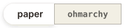
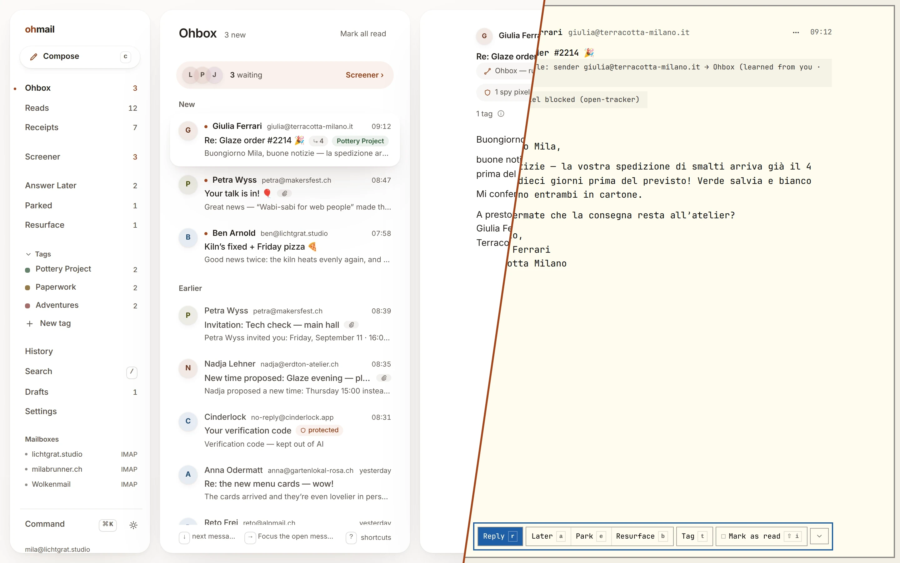
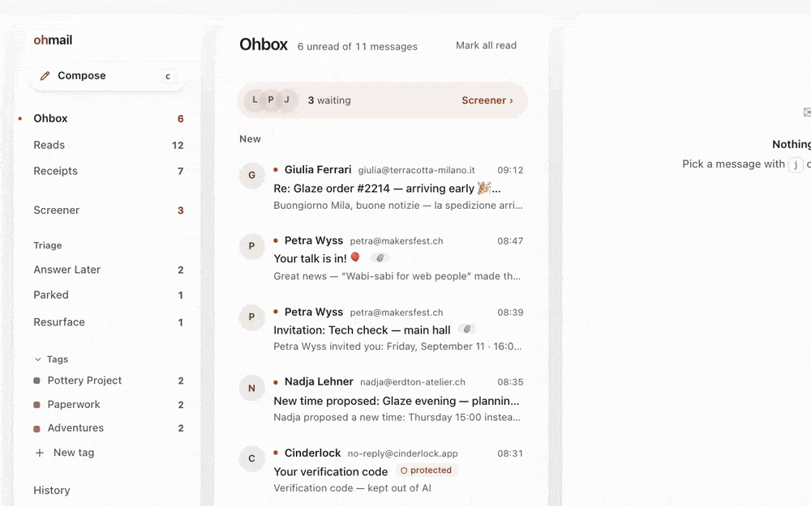
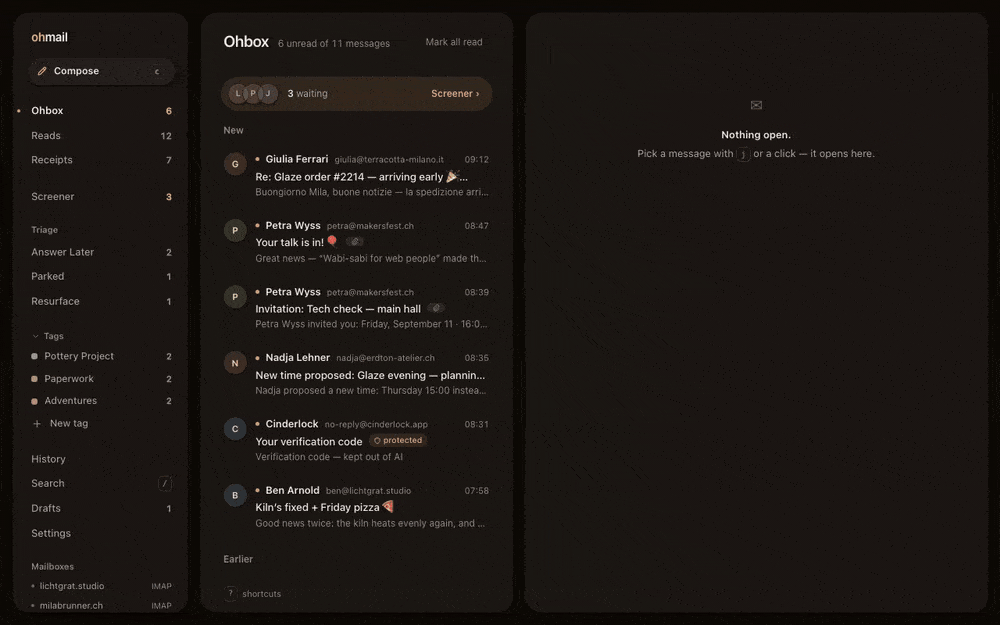
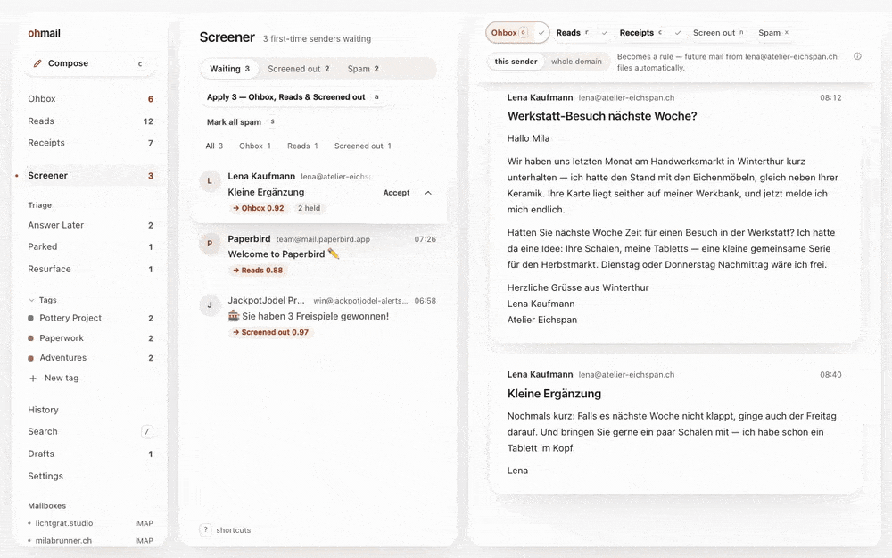
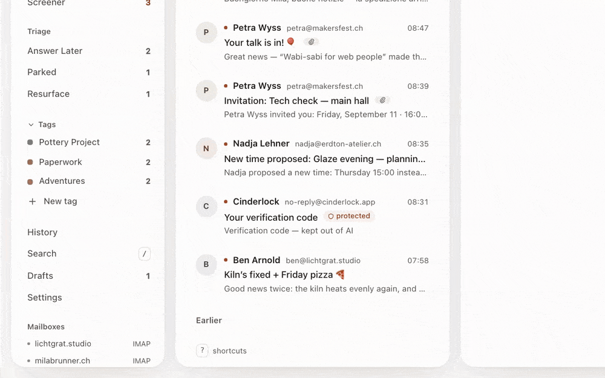
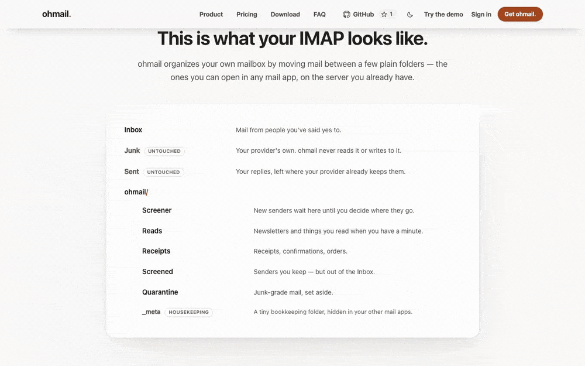
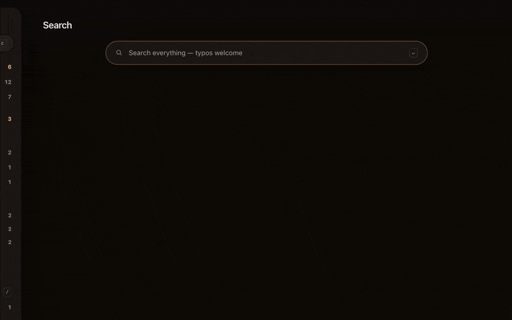
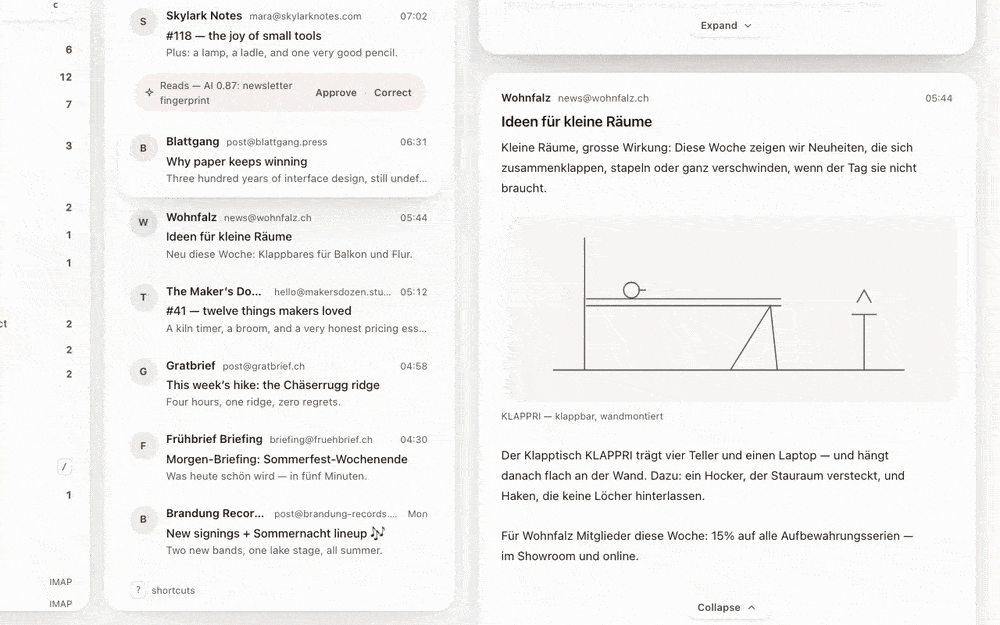
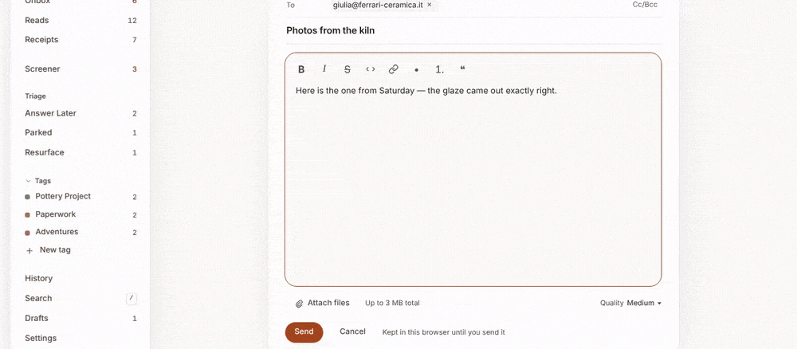

<div align="center">


# ohmail

**Consent-first email, on the mailboxes you already have.**

New senders wait at the Screener until you let them in, unless you wrote to them
first, and everything you said yes to is filed into real folders on your own
IMAP server, readable by any other mail app and kept when you leave. This
repository is the whole program, the desktop app for macOS, Windows and Linux,
the Android app, the web app and the server: all of it AGPL-3.0, and no account
needed.

Any IMAP mailbox, Gmail and Microsoft 365 / Exchange\*.

\* Microsoft 365 and Exchange connect with your Microsoft sign-in on ohmail Cloud and on self-hosted servers set up for it; some organizations require an admin to approve ohmail first. On the desktop app, a local gateway that speaks IMAP can be added — see [Local mail gateway](docs/local-mail-gateway.md).

[**Download the latest release**](https://github.com/trafficflowhq/ohmail/releases/latest) ·
[try the demo in your browser](https://ohmail.app/demo) ·
[ohmail.app](https://ohmail.app), the hosted instance of this server

[](https://github.com/trafficflowhq/ohmail/actions/workflows/build.yml)
[](https://github.com/trafficflowhq/ohmail/releases/latest)
[](LICENSE)
[](#macos)
[](#windows)
[](#linux)

</div>

<div align="center">
<sub>Choose your theme</sub><br>
<a href="README.ohmarchy.md"><picture>
<source media="(prefers-color-scheme: dark)" srcset="docs/readme/toggle-paper-dark.svg">

</picture></a>
</div>

<picture>
  <source media="(prefers-color-scheme: dark)" srcset="docs/assets/faces/hero-split-dark.webp">
  
</picture>

## How it works

Someone new who writes to you waits at the **Screener**, not in your inbox. One
press picks where the sender goes: the Ohbox, News, Receipts or Screened out.
Someone you have written to since you set up ohmail, or who answers a message
you sent, goes straight to the Ohbox.

Spam needs no AI: one press files the message into your mailbox's own Junk
folder, and the sender rule remembers, so the next mail from that sender never
reaches the Screener. The rules that file your mail are listed under
Settings → Rules, to change or revoke. ohmail deletes nothing on its own.

### Ohbox · News · Receipts

Three views instead of one pile, each a real folder on your mail server:

- **Ohbox**: the people you said yes to, new mail on top and what you have seen
  under Earlier.
- **News**: newsletters, with a waterline where you stopped reading.
- **Receipts**: receipts, confirmations and orders.

Senders you screened out keep arriving, in their own folder, out of the way.

## Your mailbox stays the source of truth

Every filing decision is a real IMAP move in your own account. Open the mailbox
in any other mail app, or stop using ohmail, and it is already organized.

## How ohmail organizes inside your mailbox

This is what your IMAP looks like. The folders ohmail creates are a small, frozen set:

```
Inbox                    mail from people you've said yes to
Junk                     your provider's own — your spam verdicts file into it
Sent                     your replies, left where your provider already keeps them
ohmail/
├── Screener             new senders wait here until you decide where they go
├── News                 newsletters and things you read when you have a minute
├── Receipts             receipts, confirmations, orders
├── Screened             senders you keep, but out of the Inbox
├── Quarantine           spam the automatic patterns set aside, held for review
└── _meta                a small bookkeeping folder; some mail apps show it
```

- There is no folder called "Spam": your spam verdicts go to the provider's own
  Junk, and delete goes to its Trash, never an expunge.
- `ohmail/_meta` holds your settings as a few kilobytes of versioned JSON: the
  senders you screened, your rules, notification choices, away reply, signature,
  tag names and screening window, never credentials or keys. Connect the mailbox
  from another install or a server and ohmail finds them and asks before using
  them. The format is [docs/organizer-profile.md](docs/organizer-profile.md).
- A lease in the same folder names the one organizer of the mailbox, so a desktop
  install and a server never fight over it. A move is recorded before it is made,
  so a crash leaves a pending move, never a half-moved mailbox.
- Triage piles, Resurface timers, learned patterns and which tag is on which
  message stay with the install they were made on.

[docs/organizing.md](docs/organizing.md) has the whole mechanism.

## Rules first, AI optional

Rules do the filing, and they need no model. AI is off until you configure it,
and then it only proposes: the Screener shows a door for each waiting sender,
with a confidence and a reason, and one press accepts. A pattern you have
confirmed often enough becomes a rule. "Act on confident suggestions for me" is
a switch you turn on, and it never files someone you have written to. A
one-time code is stripped before any model sees the message, and automatic
routing leaves that mail alone. AI never sends mail: a reply draft lands in the
editor.

With no model, the Screener still holds first contact, rules still file mail and
search still works; only the suggestion and the draft are not offered.

### Model providers and keys

The desktop app asks in **Settings → Desktop**, under *AI for suggestions and
drafts*:

- **Your Anthropic key**: requests go to `api.anthropic.com`.
- **Your OpenAI key**: requests go to `api.openai.com`.
- **Your OpenCode Go key**: requests go to `opencode.ai` and on to the provider
  behind the model you choose.
- **A model on this machine**, served by [Ollama](https://ollama.com) at
  `http://127.0.0.1:11434` by default; nothing leaves the machine if the server
  is on it.

On the desktop, a key is sealed under a key in your operating system's keystore
and is sent to no host but its own vendor's; the endpoint for each key is fixed in
the code. [docs/ai.md](docs/ai.md) has what each request carries and how a key is
checked.

A server you run reads the same four from its `.env`. There is no default Ollama
address there, and an optional `OHMAIL_ANTHROPIC_BASE_URL` sends the Anthropic
requests through a gateway you name: see
[docs/self-host/README.md](docs/self-host/README.md#screener-suggestions-and-reply-drafts).

## What else is in it

- **Search** as you type, typo-tolerant, over every message's text, subject,
  sender, recipients and attachment names.
- **All your mailboxes** (Gmail, Microsoft 365 and Outlook.com, iCloud, Fastmail,
  your own server) behind one Screener; reply from whichever address you choose.
- **History**: every message you own, newest first, back to the first one.
- **Tags** that reach across mailboxes; a message stays in its folder.
- **Answer Later, Park and Resurface**: mail parked until a day you pick comes
  back on its own.
- **Schedule send**, **Send + Done**, and drafts that save themselves.
- **Undo** on every filing verb, `z` from the keyboard.
- **Keyboard first**: `j`/`k`, one-key filing, `?` for the sheet, ⌘K or Ctrl+K
  for the command palette.
- **Light and dark**, HTML mail included, with the sender's original one click
  away; text size per device.
- **Two faces**, paper and ohmarchy, under Settings → General → Look; on Omarchy
  the desktop app follows your active theme ([docs/faces.md](docs/faces.md),
  [the demo](https://ohmail.app/#face=ohmarchy)).
- **Attachments**: images and text preview in ohmail, other files open in the
  app your computer uses for them, and Download all gives you files, not a zip.
- **Photos are compressed before they are sent**: JPEG and PNG, on your own
  device, Low, Medium, High or Original. Compressing drops the camera data,
  location included; other formats, HEIC among them, are sent as they are.
- **Tracking pixels** the blocker recognises are never requested, unless you turn
  the blocker off.
- **One-click unsubscribe** when you screen a sender out or mark spam, where the
  list offers one and your mail provider confirmed the sender; a switch turns it
  off.
- **Calendar invites** as event cards, downloadable as `.ics`.
- **Your computer's mail app**: a clicked email address opens a new message here,
  once you say yes.
- **[Your own devices](#host-your-own-devices-from-your-desktop)**, served from
  your desktop.
- **English and German**, throughout.

### What it looks like

<table>
<tr><td width="50%"></td><td width="50%"></td></tr>
<tr><td width="50%"></td><td width="50%"></td></tr>
<tr><td width="50%"></td><td width="50%"></td></tr>
<tr><td width="50%"></td><td width="50%"></td></tr>
</table>

<sub>Recorded over the demo mailbox at [ohmail.app/demo](https://ohmail.app/demo),
in an earlier release; the app itself carries no demo mail and opens empty until
you connect a mailbox.</sub>

## Where your mail is, and what the app talks to

| How you run it | Where your mail is | What the app talks to |
|---|---|---|
| **The desktop app**, the default, no account | On your mail server, mirrored (every folder but Junk, Trash and Drafts) to a database on your disk | Your provider over IMAP and SMTP, the signed update check, one-click unsubscribes, and your model provider if you turn AI on |
| **The desktop app, serving your devices** | The same | The same, and your own devices over your Tailscale tunnel |
| **A server you run** | On your mail server, with the server's working copy on your box | Your server |
| **ohmail.app**, the hosted instance of this server | On your mail server, with ohmail.app's working copy | `api.ohmail.app`, after **Sign in with browser** |

No telemetry, no analytics. Your mail password is sealed under a per-install
key, kept in your computer's keystore and mirrored to a file only your user
account can read, because an unsigned app is refused its own keystore item after
every update. The local mail mirror is an ordinary unencrypted database.

The window reaches nothing directly. It talks to the mail engine over a private
pipe, and its Content-Security-Policy names one source in `connect-src`, the
app's in-process command scheme (`apps/desktop/src-tauri/tauri.<os>.conf.json`).
[docs/architecture.md](docs/architecture.md) has how it is put together.

## Install

[Releases](https://github.com/trafficflowhq/ohmail/releases) has every file, no
GitHub account needed. Each desktop build carries the mail engine and its own
Node runtime.

| Platform | File | Requires |
|---|---|---|
| **macOS** | `ohmail.dmg` (universal, arm64 + x86_64) | macOS 15+ |
| **Windows** | `ohmail-windows-setup.exe` (per-user, no admin) | Windows 10+, x86_64 |
| **Linux · x86_64** | `ohmail-linux-x86_64.AppImage`, `ohmail-linux-amd64.deb` or `ohmail-linux-x86_64.rpm` | — |
| **Linux · arm64** | `ohmail-linux-aarch64.AppImage`, `ohmail-linux-arm64.deb` or `ohmail-linux-aarch64.rpm` | — |
| **Android** | `ohmail-android.apk` | — |

**Check what you downloaded.** Every release carries a `SHA256SUMS`:
`shasum -a 256 --check SHA256SUMS` (`sha256sum --check` on Linux).

**Updates.** The AppImage, the Windows setup and the macOS app check this
repository's release feed at launch and once a day, and verify every update
against a public key committed in this tree; a `.deb`, `.rpm` or Flatpak install
updates through your package manager. [docs/install.md](docs/install.md#updates)
has the rest.

The desktop installers carry no code-signing certificate yet, so first launch
needs one approval.

### macOS

**Right-click (or Control-click) ohmail.app → Open → Open.** Gatekeeper may say
the app "is damaged"; it is not, it has no Developer ID signature.

### Windows

SmartScreen shows "Windows protected your PC": **More info → Run anyway.** The
installer downloads Microsoft's WebView2 runtime only if it is missing.

### Linux

```bash
chmod +x ohmail-linux-x86_64.AppImage && ./ohmail-linux-x86_64.AppImage   # AppImage
sudo apt install ./ohmail-linux-amd64.deb                                 # Debian, Ubuntu
sudo dnf install ./ohmail-linux-x86_64.rpm                                # Fedora, RHEL; zypper on openSUSE
```

`uname -m` picks the files: on `aarch64`, the same with the `aarch64` and `arm64`
files. Flatpak (built from the manifest here, not on Flathub yet), a window that
never draws, and uninstalling: [docs/install.md](docs/install.md#linux).

### Android

The phone app pairs with a desktop serving your devices or with a server (yours,
or ohmail.app), or organizes one IMAP mailbox on the phone by itself.

## Run the server yourself

The server behind ohmail.app is in this repository and runs on your own box:
one compose file, prebuilt images for amd64 and arm64, no account and no
billing. Every limit is off and mailboxes are unmetered.

```bash
git clone https://github.com/trafficflowhq/ohmail.git
cd ohmail/deploy/selfhost
cp .env.example .env      # five required values; the file explains each
docker compose up -d
docker compose logs api   # the first-run setup token is printed here, once
```

Open your `OHMAIL_ORIGIN` and register with that token; there is no public
signup. [docs/self-host](docs/self-host/README.md) has the guides: a VPS from
nothing, an Umbrel package (a draft), and backups.

### Host your own devices from your desktop

A desktop app that organizes your own mailbox is already the whole organizer,
with no server in the path, and it can serve that mailbox to your other devices:
**Settings → Devices**, one switch. The engine listens on this computer only,
[Tailscale](https://tailscale.com) carries it to your phone under a real HTTPS
address, and a device pairs by scanning a QR code. Nothing is opened to the
internet, and turned off there is no listener.
[docs/self-host/host-mode.md](docs/self-host/host-mode.md) has the details.

## Build and contribute

Node 22 and stable Rust. The interface, rendered headlessly and audited offline,
needs only Node:

```bash
cd apps/desktop
npm ci                   # apps/desktop has its own lockfile
npm run ui:build:engine  # → dist/, the bundle the app embeds
npm run smoke            # → SMOKE OK — renders, offline audit included
```

The whole build, with the mail engine in it: [docs/build.md](docs/build.md).

Every change reaches `main` as a pull request, ours included, and is merged only
once its required checks pass. Sign your commits with `git commit -s` (DCO, no
CLA). [CONTRIBUTING.md](CONTRIBUTING.md) has the rest; open an issue before an
IMAP or sync change. [CHANGELOG.md](CHANGELOG.md) records what has shipped.

## Roadmap

1. **Signed installers**: a notarized DMG with a real Apple Developer ID and an
   Authenticode-signed `.exe`. Updates are already signed and verified; this is
   about the first launch.
2. **A packaged Linux repository**: an apt source and a properly signed AppImage,
   so an install is a command rather than a download and a `chmod`.

Dates are not promised. The order is.

## Licence

AGPL-3.0. Copyright © 2026 **TrafficFlow GmbH**, Staubstrasse 1, 8038
Zürich, Switzerland.

Anyone can use, study, change and share this code, and anyone who redistributes
a changed version, or runs one as a network service for other people, must
publish their changes under the same terms. Everything ohmail runs on is here;
the only private code is the machinery for billing our hosted customers, and
that service's staff console and deploy configuration. None of it is needed to
run ohmail, and billing reaches this server over a documented API
(`packages/db/src/entitlements-client.ts` is the open client). Full text in
[LICENSE](LICENSE); the reasoning in [COPYRIGHT](COPYRIGHT).

**The code is free; the name and the icon are not.** A fork you publish, and any
hosting service you run on this code, needs its own name and artwork.
[TRADEMARK.md](TRADEMARK.md) is the policy; packaging ohmail for a distribution
under its own name is fine. Security reports: [SECURITY.md](SECURITY.md).

---

<div align="center">

[ohmail.app](https://ohmail.app) · [issues](https://github.com/trafficflowhq/ohmail/issues) · support@ohmail.app

Built in Zürich by [TrafficFlow GmbH](https://trafficflow.ch).

</div>
