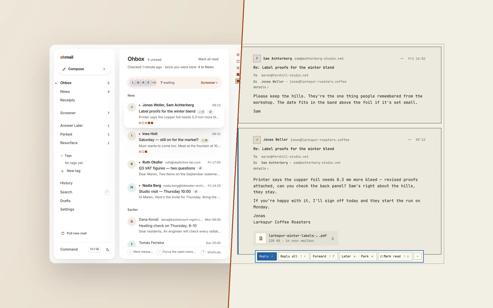
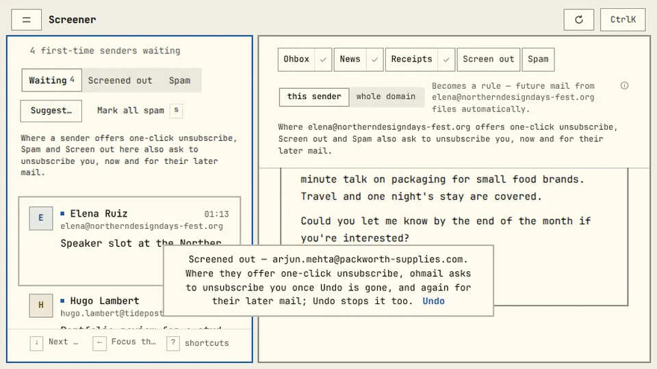
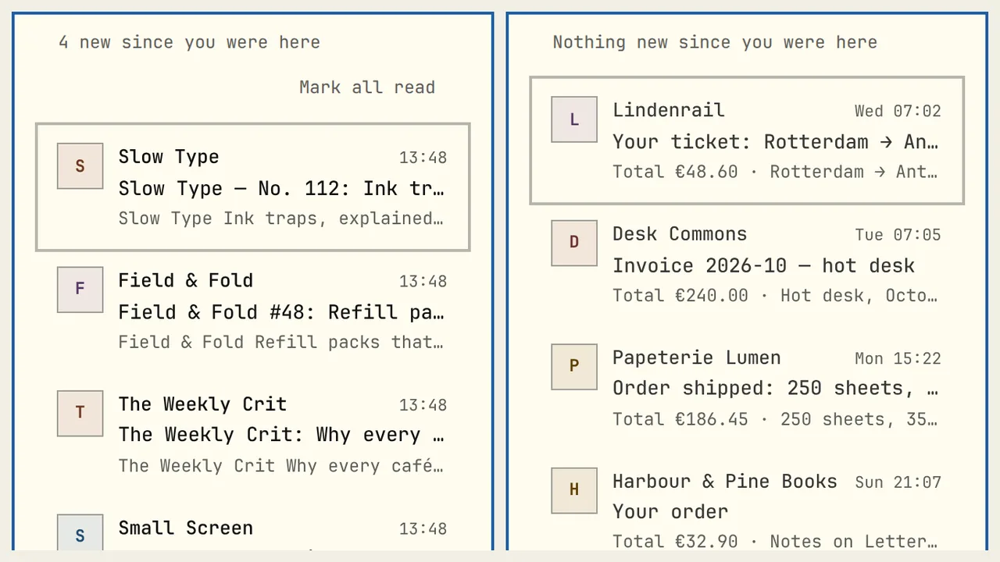
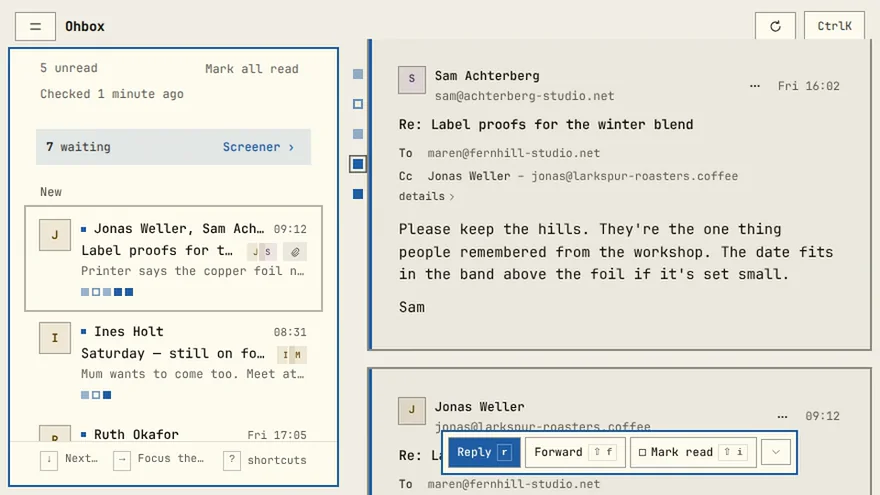
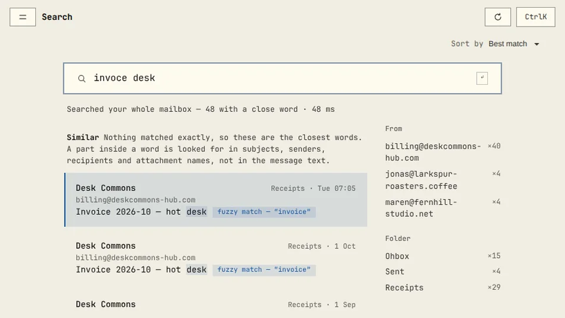
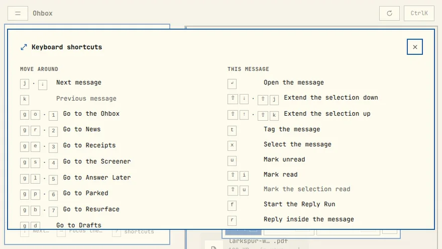
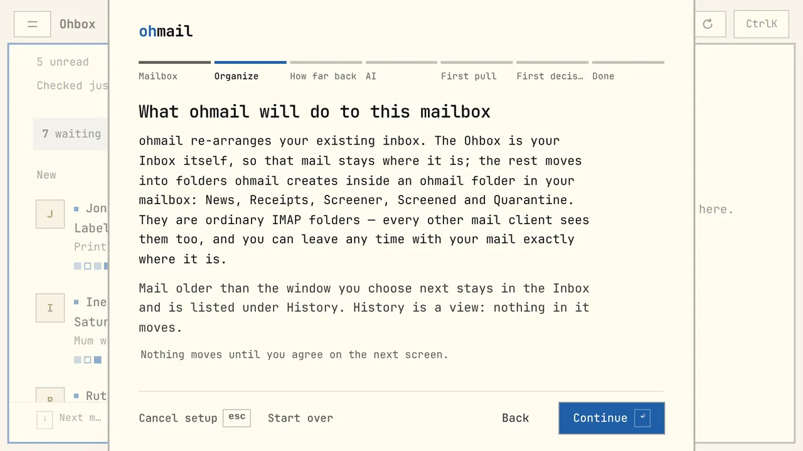
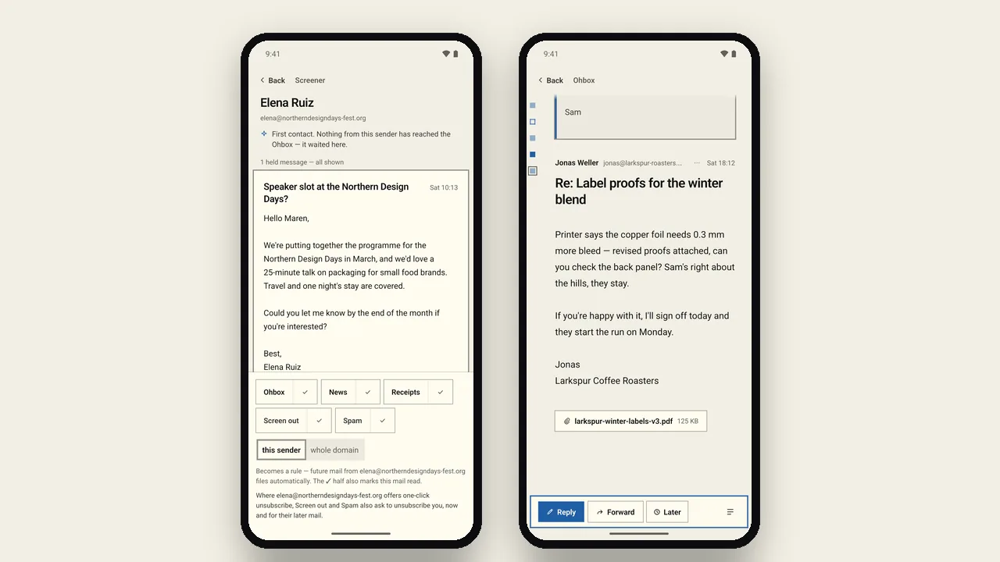
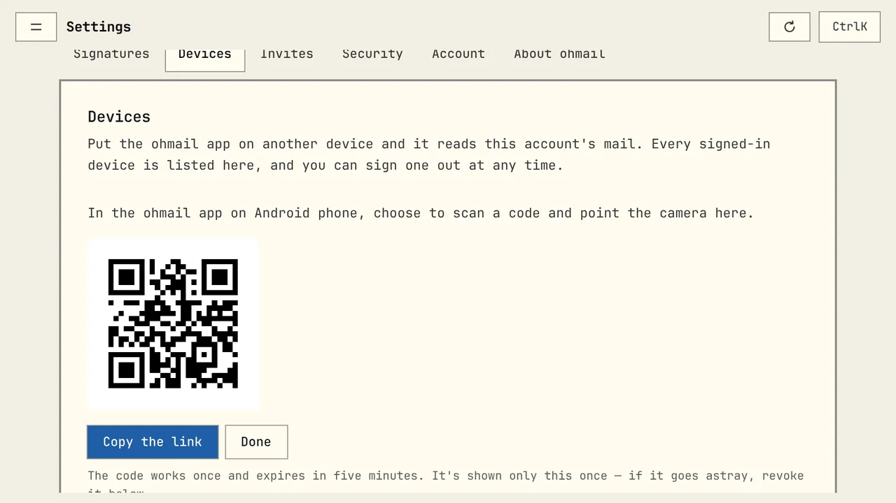

<p align="center">
  <a href="https://ohmail.app"></a>
</p>

<p align="center">
  <a href="https://github.com/trafficflowhq/ohmail/stargazers"></a>
  <a href="https://github.com/trafficflowhq/ohmail/releases"></a>
  <a href="https://github.com/trafficflowhq/ohmail/releases/latest"></a>
  <a href="LICENSE"></a>
  
</p>

<p align="center">
  <picture>
    <source media="(prefers-color-scheme: dark)" srcset="docs/assets/readme/heading-dark.svg">
    
  </picture>
</p>

<p align="center">
  Mail that sorts itself into <strong>real IMAP folders</strong>. New senders wait at the Screener. Decide once, and ohmail files the rest.
</p>

<h3 align="center"><a href="https://github.com/trafficflowhq/ohmail/releases/latest"><ins>Download ohmail</ins></a></h3>

<p align="center">
  <sub>or <a href="https://ohmail.app/demo">try the demo in your browser</a> · <a href="https://ohmail.app">ohmail.app</a>, the hosted instance</sub>
</p>

<p align="center">
  <sub>Choose a face</sub><br/>
  <a href="README.md"><picture>
    <source media="(prefers-color-scheme: dark)" srcset="docs/assets/readme/toggle-ohmarchy-dark.svg">
    
  </picture></a>
</p>

<p align="center">
  <picture>
    <source media="(prefers-color-scheme: dark)" srcset="docs/assets/readme/hero-dark.webp">
    
  </picture><br/>
  <sub>paper on the left, ohmarchy on the right: <a href="#two-faces-paper-and-ohmarchy">two faces</a> of one app</sub>
</p>

## Features

<table>
<tr><td width="50%" valign="middle">

### The Screener

People who write to you for the first time wait here until you decide once, for that address or the whole domain. Anyone you wrote to first goes straight in. Optionally, a model helps: it is asked about new senders as their mail arrives, in the cloud or on your own machine, and can file the ones it is sure about. Both are off until you switch them on.

</td><td width="50%">
<a href="docs/assets/readme/ohmarchy-screener-light.gif"><picture><source media="(prefers-color-scheme: dark)" srcset="docs/assets/readme/ohmarchy-screener-dark.gif" type="image/gif"><source srcset="docs/assets/readme/ohmarchy-screener-light.gif" type="image/gif"></picture></a>
</td></tr>
<tr><td width="50%" valign="middle">

### News and Receipts

Newsletters get their own list with a line where you stopped. Orders, tickets and invoices get theirs, out of the Ohbox.

</td><td width="50%">
<picture><source media="(prefers-color-scheme: dark)" srcset="docs/assets/readme/ohmarchy-news-receipts-dark.webp"></picture>
</td></tr>
<tr><td width="50%" valign="middle">

### Conversations, read as you see them

A conversation is one row in the Ohbox, your inbox. Open it and its unread messages sit on a tinted panel, with one square per message beside them that settles once you have actually seen it.

</td><td width="50%">
<a href="docs/assets/readme/ohmarchy-ohbox-thread-light.gif"><picture><source media="(prefers-color-scheme: dark)" srcset="docs/assets/readme/ohmarchy-ohbox-thread-dark.gif" type="image/gif"><source srcset="docs/assets/readme/ohmarchy-ohbox-thread-light.gif" type="image/gif"></picture></a>
</td></tr>
<tr><td width="50%" valign="middle">

### Search your whole mailbox

Search answers as you type, forgives typos, covers your whole mailbox and says how long it took.

</td><td width="50%">
<a href="docs/assets/readme/ohmarchy-search-light.gif"><picture><source media="(prefers-color-scheme: dark)" srcset="docs/assets/readme/ohmarchy-search-dark.gif" type="image/gif"><source srcset="docs/assets/readme/ohmarchy-search-light.gif" type="image/gif"></picture></a>
</td></tr>
<tr><td width="50%" valign="middle">

### Keyboard first

Every verb has a key: j and k to move, e to park, a to answer later, z to undo, g and a letter to jump, and ? shows the whole sheet.

</td><td width="50%">
<a href="docs/assets/readme/ohmarchy-keyboard-light.gif"><picture><source media="(prefers-color-scheme: dark)" srcset="docs/assets/readme/ohmarchy-keyboard-dark.gif" type="image/gif"><source srcset="docs/assets/readme/ohmarchy-keyboard-light.gif" type="image/gif"></picture></a>
</td></tr>
<tr><td width="50%" valign="middle">

### Your mailbox stays the source of truth

Filing is a real IMAP move into a few plain folders, and your rules are stored in the mailbox itself. Any other mail app sees the result, and nothing is lost if you leave.

[How it works →](docs/how-it-works.md) · [Format →](docs/organizer-profile.md)

</td><td width="50%">
<picture><source media="(prefers-color-scheme: dark)" srcset="docs/assets/readme/ohmarchy-source-of-truth-dark.webp"></picture>
</td></tr>
<tr><td width="50%" valign="middle">

### On your phone

The Android app organizes one mailbox on its own, or keeps a copy of a mailbox your desktop, ohmail.app or your own server organizes.

[Android APK](https://github.com/trafficflowhq/ohmail/releases/latest/download/ohmail-android.apk)

</td><td width="50%">
<picture><source media="(prefers-color-scheme: dark)" srcset="docs/assets/readme/ohmarchy-phone-dark.webp"></picture>
</td></tr>
<tr><td width="50%" valign="middle">

### Run it yourself

Run the whole stack on your own box with Docker Compose and pair your phone from Settings → Devices. Or switch on Devices in the desktop app, and it becomes the server for your phone over Tailscale.

[Self-hosting →](docs/self-host/README.md)

</td><td width="50%">
<picture><source media="(prefers-color-scheme: dark)" srcset="docs/assets/readme/ohmarchy-run-it-yourself-dark.webp"></picture>
</td></tr>
</table>

**Also in the box:**

- **Rules you can read**: every decision is a rule under Settings → Rules that you can change or revoke, and moving a message yourself teaches the rule that filed it.
- **AI only if you want it**: your own Anthropic, OpenAI or OpenCode Go key, or a local model through Ollama, suggests where a sender's mail goes and drafts a reply. Nothing is filed for you unless you switch that on, and one-time codes are stripped before a model sees the mail.
- **Answer Later, Park and Resurface**: queue the mail you owe a reply and answer it one at a time in the Reply Run, or put mail away until the day it should come back.
- **History**: every message you own, newest first, with the months and years on the side to jump anywhere.
- **Spam** goes to your provider's own Junk folder. ohmail deletes nothing on its own.
- **Lists**: screening a list out sends its one-click unsubscribe once the sender is confirmed.
- **Calendar invites** as an event card, **Send later**, **Send + Done**, and one **Undo** (z) for every filing verb.
- **Pictures on your terms**: pictures are fetched by your own device, and a tracking pixel the blocker recognises is never requested.
- **Your system's mail app**: ohmail can be your default mail app, so an email link opens a new message, already filled in.
- **English and German**, throughout. The [changelog](CHANGELOG.md) is the full list.

## Two faces: paper and ohmarchy

One app, two faces. **paper** is the default everywhere but Linux: light, soft corners, shadow instead of line. **ohmarchy** is for people who live in a tiling window manager, after [Omarchy](https://omarchy.org): hard corners, drawn borders, mono type, panes with real gaps. Same features, same keys; only the tokens change. On Linux the app starts in ohmarchy, on Omarchy the desktop app follows your theme as you switch it, and an [Omarchy plugin](deploy/omarchy-plugin/README.md) puts your unread count in the bar. Your own choice wins, under Settings → General → Look. This README has a [twin in the other face](README.md); the switch at the top flips every screenshot below the header, and not one sentence.

---

## Works with your mailbox

<kbd>Gmail</kbd> · <kbd>iCloud</kbd> · <kbd>Fastmail</kbd> · <kbd>Microsoft 365\*</kbd> · <kbd>any IMAP server</kbd>

<sub>[Gmail](docs/connect-gmail.md) connects with an app password. \*Microsoft 365 connects with your Microsoft sign-in on ohmail.app and on self-hosted servers set up for it; on the desktop, through a [local mail gateway](docs/local-mail-gateway.md).</sub>

## Install

### Desktop: macOS, Windows, Linux

| Platform | Download |
|---|---|
| **macOS** (Apple silicon and Intel) | [ohmail.dmg](https://github.com/trafficflowhq/ohmail/releases/latest/download/ohmail.dmg) |
| **Windows** (x86_64) | [ohmail-windows-setup.exe](https://github.com/trafficflowhq/ohmail/releases/latest/download/ohmail-windows-setup.exe) |
| **Linux** (x86_64) | [AppImage](https://github.com/trafficflowhq/ohmail/releases/latest/download/ohmail-linux-x86_64.AppImage) · [.deb](https://github.com/trafficflowhq/ohmail/releases/latest/download/ohmail-linux-amd64.deb) · [.rpm](https://github.com/trafficflowhq/ohmail/releases/latest/download/ohmail-linux-x86_64.rpm) |
| **Linux** (arm64) | [AppImage](https://github.com/trafficflowhq/ohmail/releases/latest/download/ohmail-linux-aarch64.AppImage) · [.deb](https://github.com/trafficflowhq/ohmail/releases/latest/download/ohmail-linux-arm64.deb) · [.rpm](https://github.com/trafficflowhq/ohmail/releases/latest/download/ohmail-linux-aarch64.rpm) |

[All builds and checksums](https://github.com/trafficflowhq/ohmail/releases/latest). The builds are not code-signed yet, so the first launch on macOS and Windows needs one manual approval: [what to press](docs/install.md).

```bash
chmod +x ohmail-linux-x86_64.AppImage && ./ohmail-linux-x86_64.AppImage   # AppImage
sudo apt install ./ohmail-linux-amd64.deb                                 # Debian, Ubuntu
sudo dnf install ./ohmail-linux-x86_64.rpm                                # Fedora
```

### Phone: Android

[ohmail-android.apk](https://github.com/trafficflowhq/ohmail/releases/latest/download/ohmail-android.apk). The phone can organize one mailbox on its own, or pair with the desktop app, ohmail.app or your own server and keep a copy.

### Your own server

```bash
git clone https://github.com/trafficflowhq/ohmail.git
cd ohmail/deploy/selfhost
cp .env.example .env      # fill in the required values; the file explains each
docker compose up -d
docker compose logs api   # prints the one-time setup token
```

On a server with a public domain, also set `OHMAIL_BIND=0.0.0.0` in `.env`. Prebuilt images for amd64 and arm64; the [self-hosting guide](docs/self-host/README.md) takes you from an empty VPS to backups.

### Hosted

[ohmail.app](https://ohmail.app) runs the same server source.

## Privacy

There is no telemetry and no analytics in the apps. ohmail Cloud keeps one record of its own about connecting a mailbox ([ohmail.app/privacy](https://ohmail.app/privacy)); a self-hosted server and the desktop app keep none. In local mode on the desktop, only these leave the machine: the connections to your mail server, the signed update check, pictures in a message you open, one-click unsubscribes, lookups of the keys senders sign mail with, and, if you turn it on, requests to your model provider. [Where your mail is, and what the app talks to →](docs/how-it-works.md#where-your-mail-is-and-what-the-app-talks-to)

## Community & support

- Bugs and ideas: [GitHub issues](https://github.com/trafficflowhq/ohmail/issues)
- Vulnerabilities: [SECURITY.md](SECURITY.md), not a public issue
- Star the repo to follow releases

## Developing

Read [CONTRIBUTING.md](CONTRIBUTING.md) first: every change is a pull request with a DCO sign-off (`git commit -s`) and a `changelog.d/` entry. `apps/webapp` is the client, `apps/desktop` the desktop shell, `apps/mobile` the phone app, `apps/sidecar` the desktop's mail engine, `packages/core` the organizer, `deploy/selfhost` the server stack. [Build from source](docs/install.md#build-the-desktop-app-yourself).

## License

[AGPL-3.0](LICENSE) for the whole program: desktop, phone, web and server. The name and the icon are covered by [TRADEMARK.md](TRADEMARK.md).
