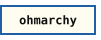
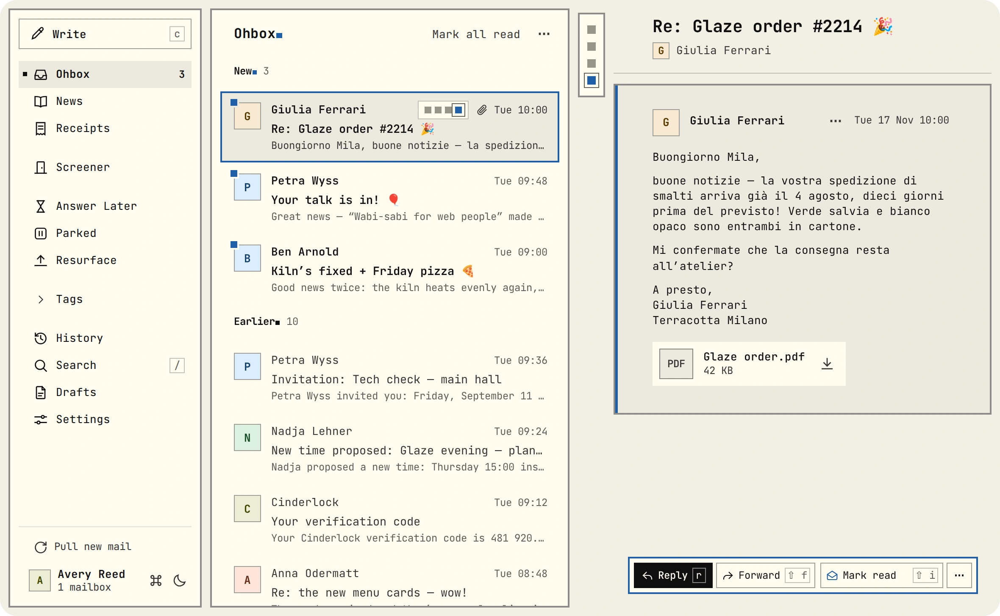
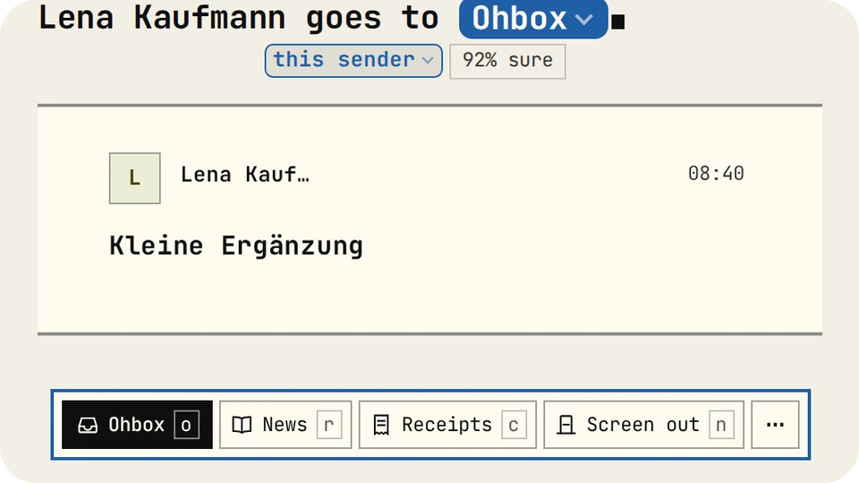
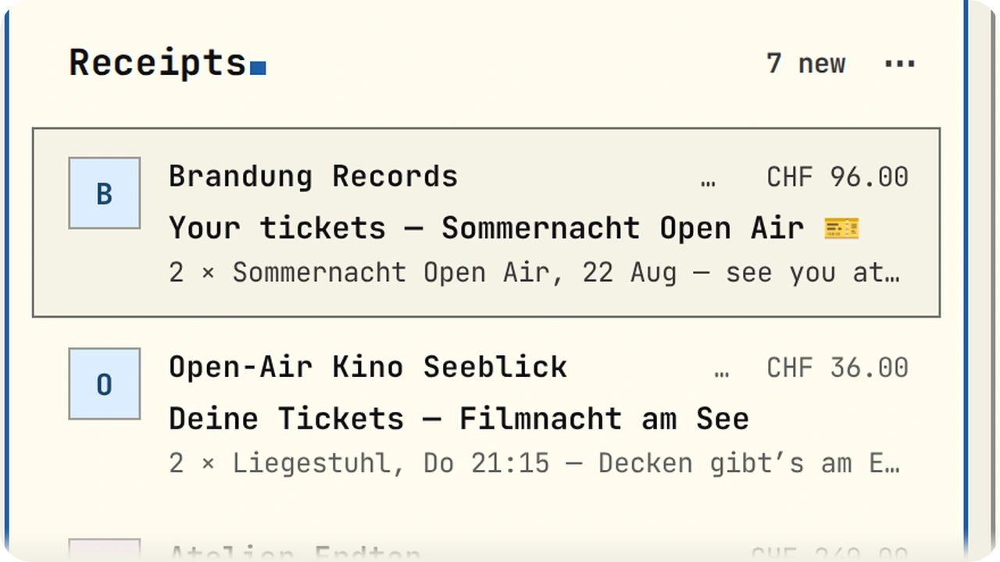
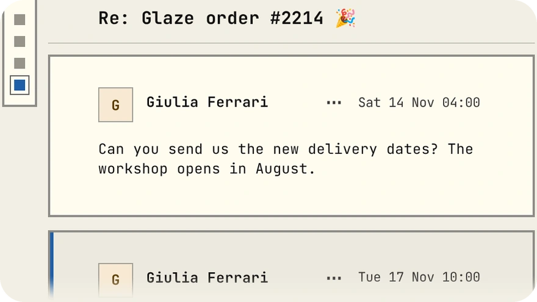
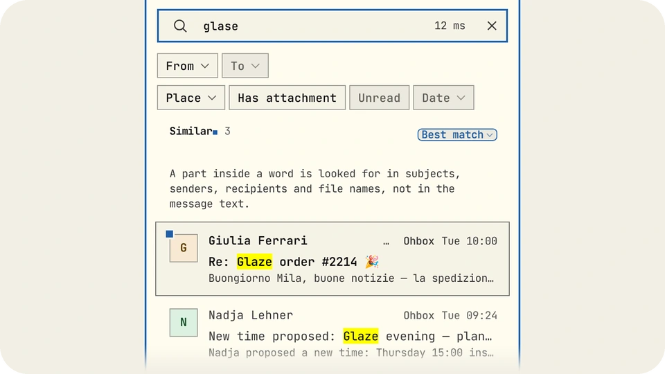
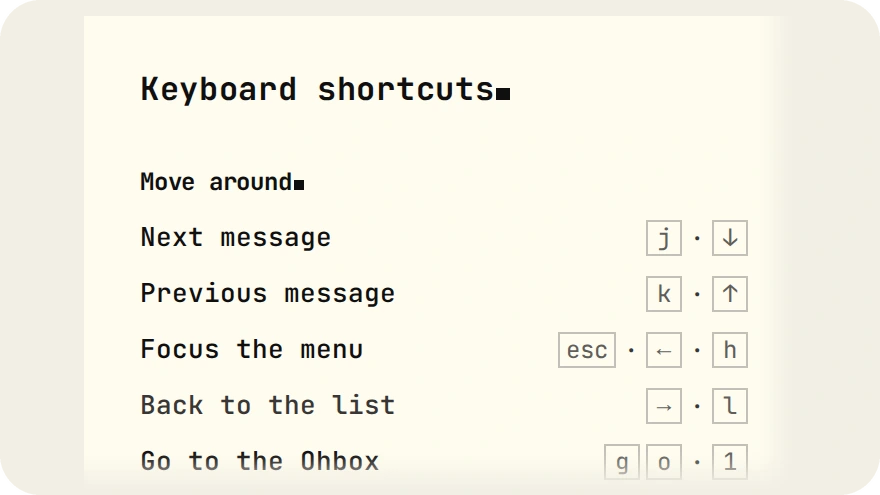
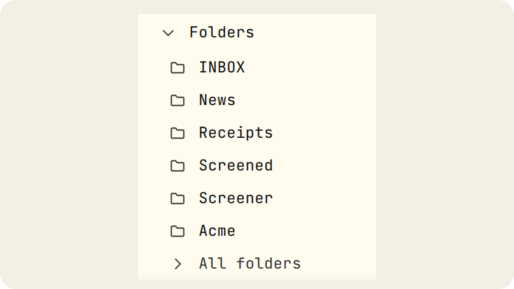
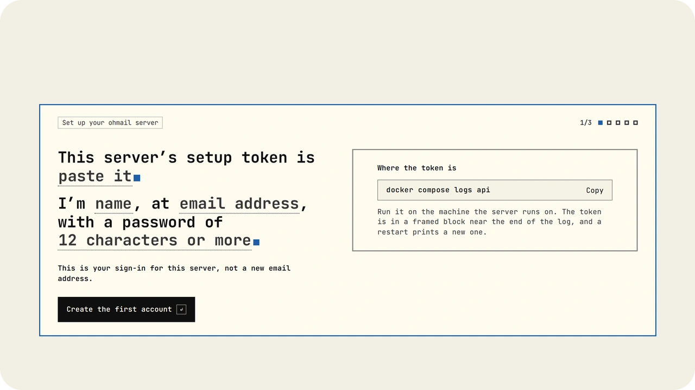

<p align="center">
  <a href="https://ohmail.app"></a>
</p>

<p align="center">
  <picture>
    <source media="(prefers-color-scheme: dark)" srcset="docs/assets/readme/headline-dark.svg">
    
  </picture>
</p>

<p align="center">
  On your own mailboxes. &nbsp;AI accelerated if&nbsp;you&nbsp;want&nbsp;it.<br/>On &nbsp;Linux, &nbsp;macOS, &nbsp;Windows,<br/>&nbsp;iOS&nbsp;and&nbsp;&nbsp;Android.
</p>

<p align="center">In 2.0, Calendar is available in ohmail Cloud and on self-hosted servers (<code>OHMAIL_CALENDAR=1</code> by default). Connect iCloud, CalDAV or read-only subscribed ICS feeds. Standalone Desktop supports mail only.</p>

<h3 align="center"><a href="https://github.com/trafficflowhq/ohmail/releases/latest">Download ohmail</a></h3>

<p align="center">
  <sub>or <a href="https://ohmail.app/demo">try the demo in your browser</a> · <a href="#run-the-server-yourself">run it yourself</a> · <a href="https://ohmail.app">ohmail.app</a>, the one we host</sub>
</p>

<p align="center">
  <a href="https://github.com/trafficflowhq/ohmail/releases/latest"></a>
  <a href="https://github.com/trafficflowhq/ohmail/releases"></a>
  <a href="https://github.com/trafficflowhq/ohmail"></a>
  <a href="LICENSE"></a>
</p>

<p align="center">
  <sub>Choose a face</sub><br/>
  <a href="README.md"><picture><source media="(prefers-color-scheme: dark)" srcset="docs/assets/readme/toggle-oh-off-dark.svg"></picture></a><a
    href="README.ohmarchy.md"><picture><source media="(prefers-color-scheme: dark)" srcset="docs/assets/readme/toggle-ohmarchy-on-dark.svg"></picture></a>
</p>

<p align="center">
  <picture>
    <source media="(prefers-color-scheme: dark)" srcset="docs/assets/readme/ohmarchy-window-dark.webp">
    
  </picture>
</p>

## What it does

<table>
<tr><td width="53%" valign="middle">

### The Screener

People who write to you for the first time wait here until you decide, once, for that address or the whole domain. Anyone you wrote to first goes straight in.

</td><td width="47%">
<picture><source media="(prefers-color-scheme: dark)" srcset="docs/assets/readme/ohmarchy-row-screener-dark.webp"></picture>
</td></tr>
<tr><td width="53%" valign="middle">

### News and Receipts

Newsletters get their own list, with a line where you stopped. Orders, tickets and invoices get theirs, out of the Ohbox.

</td><td width="47%">
<picture><source media="(prefers-color-scheme: dark)" srcset="docs/assets/readme/ohmarchy-row-receipts-dark.webp"></picture>
</td></tr>
<tr><td width="53%" valign="middle">

### Conversations, read as you see them

A conversation is one row in the Ohbox, which is your `Inbox` folder. Open it and its unread messages sit on a tinted panel. Beside them is one square per message, and a square settles once you have seen its message.

</td><td width="47%">
<picture><source media="(prefers-color-scheme: dark)" srcset="docs/assets/readme/ohmarchy-row-conversation-dark.webp"></picture>
</td></tr>
<tr><td width="53%" valign="middle">

### Search

Search answers as you type, forgives typos, covers your whole mailbox and says how long it took.

</td><td width="47%">
<picture><source media="(prefers-color-scheme: dark)" srcset="docs/assets/readme/ohmarchy-row-search-dark.webp"></picture>
</td></tr>
<tr><td width="53%" valign="middle">

### Keyboard first

Every verb has a key: <kbd>j</kbd> and <kbd>k</kbd> to move, <kbd>e</kbd> to park, <kbd>a</kbd> to answer later, <kbd>z</kbd> to undo, <kbd>g</kbd> and a letter to jump. <kbd>?</kbd> shows the whole sheet.

</td><td width="47%">
<picture><source media="(prefers-color-scheme: dark)" srcset="docs/assets/readme/ohmarchy-row-keys-dark.webp"></picture>
</td></tr>
<tr><td width="53%" valign="middle">

### Your mailbox stays the source of truth

Filing is a real IMAP move into a few plain folders, and your rules are stored in the mailbox itself. Mail, its IMAP folders and the organizer profile travel with your mailbox. Piles, Resurface timers, learned patterns, tag assignments, notes and snippets stay where they were made.

[How it works](docs/how-it-works.md) · [The settings format](docs/organizer-profile.md)

</td><td width="47%">
<picture><source media="(prefers-color-scheme: dark)" srcset="docs/assets/readme/ohmarchy-row-folders-dark.webp"></picture>
</td></tr>
<tr><td colspan="2" valign="middle">

### On your phone

ohmail 2.0 keeps the 1.0 phone interface on iPhone and Android.

&nbsp;iPhone: [on the App Store][app-store], not yet available in the EU<br/>&nbsp;Android: [on Google Play][google-play] · [ohmail-android.apk](https://github.com/trafficflowhq/ohmail/releases/latest/download/ohmail-android.apk)

</td></tr>
<tr><td width="53%" valign="middle">

### Run it yourself

Run the whole stack on your own box with Docker Compose.

[Self-hosting](docs/self-host/README.md)

</td><td width="47%">
<picture><source media="(prefers-color-scheme: dark)" srcset="docs/assets/readme/ohmarchy-row-selfhost-dark.webp"></picture>
</td></tr>
</table>

<details>
<summary>Also in the box: rules you can read, AI only if you want it, Answer Later, History, Send later, one Undo</summary>

- **Rules you can read.** Every decision is a rule under Settings › Rules that you can change or revoke. Moving a message yourself teaches the rule that filed it.
- **AI only if you want it.** Standalone Desktop uses your own Anthropic, OpenAI or OpenCode Go key, or a local model through Ollama. Cloud uses its built-in AI and your plan credits; a self-hosted server uses the provider its operator configures. Suggestions and drafts are optional in each mode. Automatic asking and filing are off until enabled; sensitive mail is not filed automatically. Mail containing one-time codes or other authentication material is not sent to a model.
- **Impersonations go to Spam.** A waiting message that presents itself as a company it cannot be from goes to Spam on its own, without AI and without a rule, and stays in ohmail's own Spam. The Screener lists each one with its reason and Put back. Messages with a code in them stay where you see them. You can switch it off.
- **Answer Later, Park and Resurface.** Queue the mail you owe a reply and answer it one at a time in the Reply Run. Or put mail away until the day it should come back.
- **History.** Every message you own, newest first, with the months and years on the side to jump anywhere.
- **Spam.** What you mark as spam goes to your provider's own Junk folder. ohmail deletes nothing on its own.
- **Lists.** When a confirmed list offers one-click unsubscribe, screening it out can send the request. Turn it off with **Unsubscribe when I screen out or mark spam** in Settings. A sent unsubscribe request cannot be undone.
- **Calendar invites** as an event card, **Send later**, **Send + Done** and **Undo** (<kbd>z</kbd>) for filing actions.
- **Tracking pixels.** Recognized tracking pixels are blocked by default. You can turn blocking off; then they load with pictures.
- **Your system's mail app.** ohmail can be your default mail app, so a `mailto:` link opens a new message, already filled in.
- **English and German**, throughout. The [changelog](CHANGELOG.md) is the full list.

</details>

ohmail also has an ohmarchy look, after [Omarchy](https://omarchy.org). On Linux the app starts in it, and on Omarchy it follows your theme.

## Works with your mailbox

Gmail, iCloud, Fastmail, Microsoft 365 and any IMAP server. [Gmail](docs/connect-gmail.md) connects with an app password. Microsoft 365 connects as described below. On the desktop it connects through a [local mail gateway](docs/local-mail-gateway.md).

\* Microsoft 365 connects with your Microsoft sign-in on ohmail Cloud and on self-hosted servers set up for it.

## Install

The builds are not code-signed yet, so the first launch on macOS and Windows needs one manual approval: [what to press](docs/install.md).

| Platform | Download |
|---|---|
| &nbsp;**Linux** (x86_64) | [AppImage](https://github.com/trafficflowhq/ohmail/releases/latest/download/ohmail-linux-x86_64.AppImage) · [.deb](https://github.com/trafficflowhq/ohmail/releases/latest/download/ohmail-linux-amd64.deb) · [.rpm](https://github.com/trafficflowhq/ohmail/releases/latest/download/ohmail-linux-x86_64.rpm) |
| &nbsp;**Linux** (arm64) | [AppImage](https://github.com/trafficflowhq/ohmail/releases/latest/download/ohmail-linux-aarch64.AppImage) · [.deb](https://github.com/trafficflowhq/ohmail/releases/latest/download/ohmail-linux-arm64.deb) · [.rpm](https://github.com/trafficflowhq/ohmail/releases/latest/download/ohmail-linux-aarch64.rpm) |
| &nbsp;**macOS** 15 or later (Apple silicon and Intel) | [ohmail.dmg](https://github.com/trafficflowhq/ohmail/releases/latest/download/ohmail.dmg) |
| &nbsp;**Windows** 10 or later (x86_64) | [ohmail-windows-setup.exe](https://github.com/trafficflowhq/ohmail/releases/latest/download/ohmail-windows-setup.exe) |
| &nbsp;**iPhone** | [On the App Store][app-store], not yet available in the EU |
| &nbsp;**Android** | [on Google Play][google-play] · [ohmail-android.apk](https://github.com/trafficflowhq/ohmail/releases/latest/download/ohmail-android.apk) |

[All builds and checksums](https://github.com/trafficflowhq/ohmail/releases/latest). On Linux x86_64, after the download:

```bash
chmod +x ohmail-linux-x86_64.AppImage && ./ohmail-linux-x86_64.AppImage   # AppImage
sudo apt install ./ohmail-linux-amd64.deb                                 # Debian, Ubuntu
sudo dnf install ./ohmail-linux-x86_64.rpm                                # Fedora
```

For arm64, use the `ohmail-linux-aarch64.AppImage`, `ohmail-linux-arm64.deb` or `ohmail-linux-aarch64.rpm` files; see the [Linux install commands](docs/install.md#linux-in-detail).

### Run the server yourself

This quickstart uses the released images: 1.0 today, and 2.0 once that release is published.

```bash
git clone https://github.com/trafficflowhq/ohmail.git
cd ohmail/deploy/selfhost
cp .env.example .env      # fill in the required values; the file explains each
docker compose up -d
docker compose logs -f api # follow until the first-run setup is ready
```

Open your configured site and complete setup using the first-run information in the API log. On a server with a public domain, also set `OHMAIL_BIND=0.0.0.0` in `.env`. There are prebuilt images for amd64 and arm64. The [self-hosting guide](docs/self-host/README.md) takes you from an empty VPS to backups. [ohmail.app](https://ohmail.app) runs the same server source.

## How ohmail organizes inside your mailbox

The folders ohmail creates are a small, frozen set:

```
Inbox                    mail from people you've said yes to
Junk                     your provider's own. Your spam verdicts file into it
Sent                     your replies, left where your provider already keeps them
ohmail/
├── Screener             new senders wait here until you decide where they go
├── News                 newsletters and things you read when you have a minute
├── Receipts             receipts, confirmations, orders
├── Screened             senders you keep, but out of the Inbox
├── Quarantine           spam the automatic patterns set aside, held for review
└── _meta                a small bookkeeping folder. Some mail apps show it
```

The desktop app, ohmail Cloud and a server you run share no database. The mailbox carries your settings (senders screened in, rules and which ones you removed, notification choices, away reply, signature and tag names) as one small message of versioned JSON in `ohmail/_meta`, in a [published format](docs/organizer-profile.md). Connect the same mailbox from another of them, and ohmail finds those settings and asks before using them. Triage piles, Resurface timers, learned patterns, tag assignments, notes and snippets stay where they were made. [How it works](docs/how-it-works.md) has the rest.

## Privacy

The apps send no usage telemetry. Standalone Desktop processes mail and keeps a working copy on your computer; when signed in to Cloud, Cloud organizes mail and keeps a server copy while Desktop keeps a working copy too. ohmail Cloud keeps one record of its own about connecting a mailbox, described at [ohmail.app/privacy](https://ohmail.app/privacy). A server you run and the desktop app keep none. [What the app talks to](docs/how-it-works.md#where-your-mail-is-and-what-the-app-talks-to) lists every connection.

## Contribute

Read [CONTRIBUTING.md](CONTRIBUTING.md) first. Every change is a pull request with a DCO sign-off (`git commit -s`) and a `changelog.d/` entry. `packages/app` and `packages/ui` hold the shared client interface. `apps/webapp` hosts it on the web, and `apps/desktop` hosts it on the desktop with the mail engine in `apps/sidecar`. `apps/mobile` is the phone app. `packages/organizer` holds the organizer. `apps/server` and `apps/worker` run the server stack, with Docker Compose files in `deploy/selfhost`. [Build from source](docs/install.md#build-the-desktop-app-yourself).

Bugs and ideas go to [GitHub issues](https://github.com/trafficflowhq/ohmail/issues). Vulnerabilities go the way [SECURITY.md](SECURITY.md) describes, not into a public issue.

## License

[AGPL-3.0](LICENSE) for the whole program: desktop, phone, web and server. The name and the icon are covered by [TRADEMARK.md](docs/legal/TRADEMARK.md).

[app-store]: https://apps.apple.com/app/ohmail/id6810824816
[google-play]: https://play.google.com/store/apps/details?id=app.ohmail
